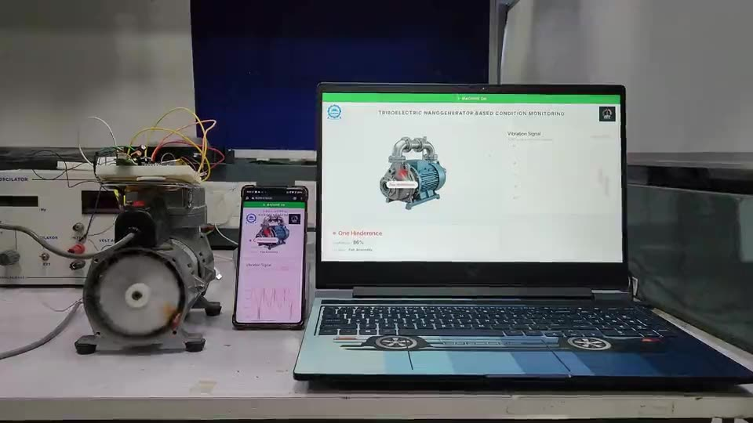

# Self-powered machine fault detection with triboelectric sensors

Triboelectric nanogenerators (TENGs) used as self-powered vibration sensors on rotating machines,
with a deep-learning pipeline that classifies seven fault conditions from the TENG signal.

> **Status:** model code, the web dashboard and sample data are being cleaned up and will be added
> to this repository. Full write-up with video: **[kaunatharva.com/work/teng-condition-monitoring](https://kaunatharva.com/work/teng-condition-monitoring)**

  

## The idea

Rotating machines show most faults as vibration before they fail. Monitoring that usually means
accelerometers, wiring and a power supply on every machine. A TENG turns mechanical vibration into
an electrical signal with no power source of its own, so the sensor is also its own generator.
The question is whether its signal carries enough information to diagnose faults.

## Stage 1: live compressor monitor

A TENG on a compressor housing, signal scaled to 3.3 V and sampled by an ESP32, classified by an
SVM into conditions such as a loose bolt, a flow restriction or a load on the crank. A web dashboard
shows the live waveform, machine status, fault type and model confidence, with a panel for
injecting test faults.

## Stage 2: deep-learning pipeline

- **STL decomposition** splits each signal into trend, seasonal and residual parts.
- A **1D-CNN** extracts features and an **LSTM** models how they evolve over time.
- Seven fault classes.

| Signal source | Accuracy |
|---|---|
| **TENG, live data from an ESP32-C3** | **98.57%** |
| Same pipeline, oscilloscope data | 97.31% |
| Conventional accelerometer | 95.83% |

## Publication

*"Realization of Digital Twin using Triboelectric Nanogenerator based Machine Skin for Machines"*,
accepted at COPEN 14 (International Conference on Precision, Meso, Micro and Nano Engineering),
December 2026. Atharva Chavan: second author (equal contribution) and presenting author.

## Credit

Instrumentation & Control Lab, IIT Indore, under **Prof. I.A. Palani**.
